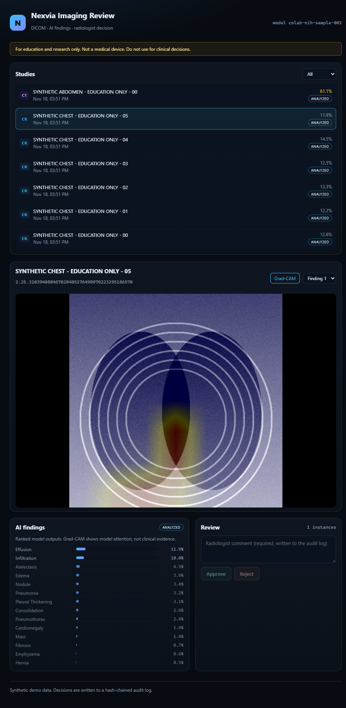
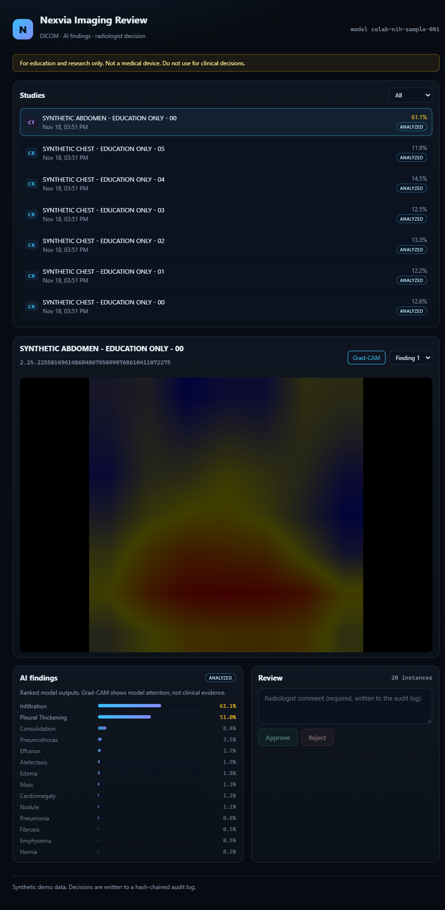
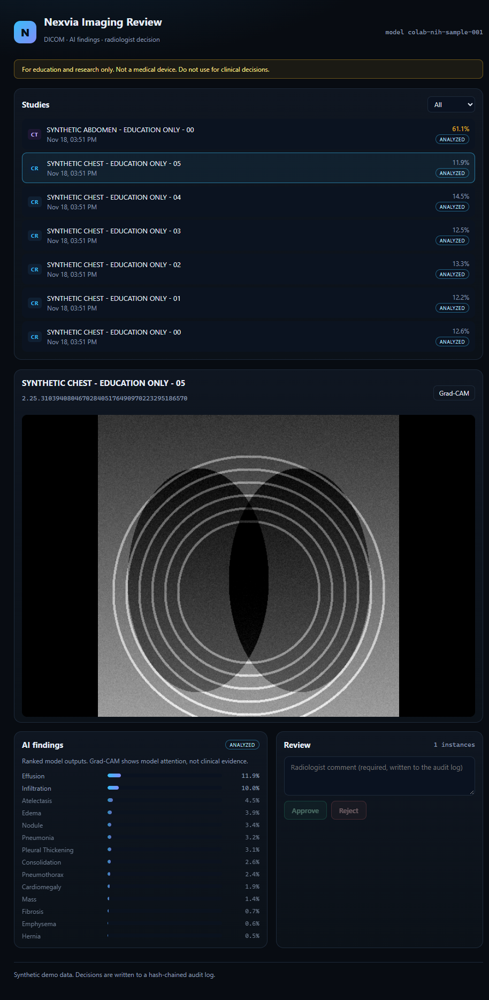

# AIML-02 — Nexvia Imaging

AI-assisted medical imaging review. Submission folder: `AIML-02` (imaging brief, course project 1).

> **Education and research only. Not a medical device. Do not use for clinical decisions.**

## What works

DICOM → Orthanc → worker → DenseNet-121 + Grad-CAM → Postgres → FastAPI → Cornerstone3D viewer → approve/reject with a hash-chained audit log.

| Piece | State |
|---|---|
| Synthetic DICOM generator (6 CR studies + 1 CT series) | done |
| Orthanc + DICOMweb client + uploader | done |
| DenseNet-121 training (NIH sample, Colab T4) | done — mean AUROC 0.775 |
| Classifier + Grad-CAM serving | done |
| Worker (stable-study polling, idempotent) | done |
| API, decisions, audit chain | done |
| React + Cornerstone3D viewer | done |
| 3D U-Net (MSD spleen), DVC | depth phase |

## Screenshots

| CR study with Grad-CAM | CT study |
|---|---|
|  |  |



## Run

```bash
docker compose up --build
```

- Viewer: <http://localhost:5174>
- API docs: <http://localhost:8000/docs>
- Orthanc: <http://localhost:8042>

The `seed` service uploads the committed synthetic studies; the worker analyzes them; the viewer lists them within a few seconds.

Without Docker, for backend tests only:

```bash
python -m pip install -e ".[dev]"
python -m pytest -q
```

## Data versioning (DVC)

```bash
dvc repro          # regenerates data/generated from params.yaml
dvc push           # sends it to the local remote (../dvc-storage)
```

The committed demo fixtures under `data/demo/` stay in git so the offline demo works without a DVC remote. The DVC stage covers regenerated data; `.dvc/config` points at a local remote, and `dvc.lock` records the stage hash.

## Training

`training/train_classifier.py` + `notebooks/train_classifier_colab.ipynb`. It trains DenseNet-121 on the official NIH ChestX-ray14 sample (5,606 images) with a patient-level split. The committed checkpoint is run `colab-nih-sample-001`:

| Metric | Value |
|---|---|
| Mean AUROC (593 test rows) | 0.775 |
| Best validation mean AUROC | 0.750 |
| Epochs / device | 5 / T4 |
| Train time | 562 s |

Per-label AUROC and the calibration caveat are in [`docs/model-card.md`](docs/model-card.md).

## Tests

```bash
python -m pytest -q        # 29 backend tests
cd dashboard && npm test   # frontend helpers
```

Covered: DICOM tag correctness, deterministic UIDs, DICOMweb client parsing, worker idempotency, API decisions/409, audit verification, classifier + Grad-CAM shape/signal.

## Docs

- [`docs/architecture.md`](docs/architecture.md)
- [`docs/api.md`](docs/api.md)
- [`docs/model-card.md`](docs/model-card.md)
- [`docs/limitations.md`](docs/limitations.md)
- Dataset setup: [`../docs/data-setup.md`](../docs/data-setup.md)

## Safety

Every synthetic object is tagged `SYNTHETIC` / `EDUCATION ONLY`. Grad-CAM is labeled as model attention, not clinical evidence. Scores at the default 0.5 threshold are not calibrated; the UI ranks all findings and highlights the top two.
