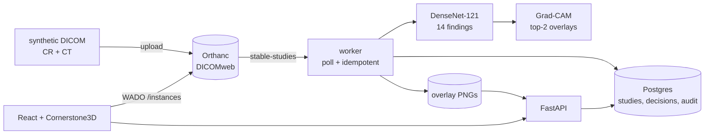
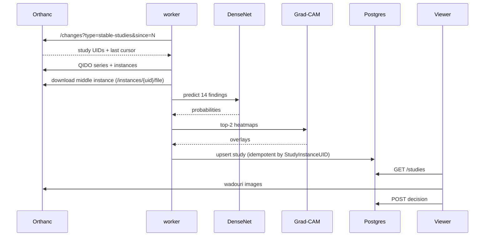

# AIML-02 — Architecture

## Flow

The worker owns inference and writes results once per study. The API is read-only except for the decision endpoint; the viewer fetches pixels directly from Orthanc and results from the API.

## Study processing

## Idempotency

- The worker cursor (`worker_cursor`) stores the last Orthanc change sequence.
- `studies.id` is the `StudyInstanceUID`; `upsert_study` replaces findings and overlays rather than inserting duplicates.
- Decisions are a conditional update from `analyzed` to `reviewed`, so a second decision returns `409`.

## Audit chain

Each decision appends a row with `hash = SHA256(prev_hash || canonical(payload))` and updates a singleton head row under a row lock. Verification walks the chain and compares the tail to the head. Rewriting both tables is still possible; external anchoring is not implemented.

## Components

| Path | Role |
|---|---|
| `src/nexvia_imaging/data/make_dicom.py` | deterministic synthetic CR/CT studies |
| `src/nexvia_imaging/dicom/client.py` | Orthanc + DICOMweb transport |
| `src/nexvia_imaging/models/classifier.py` | DenseNet-121 inference + Grad-CAM |
| `src/nexvia_imaging/worker/` | polling, processing, cursor |
| `src/nexvia_imaging/api/` | studies, decisions, audit |
| `dashboard/src/components/DicomViewer.tsx` | Cornerstone3D stack viewport |
| `training/train_classifier.py` | NIH ChestX-ray14 training |
