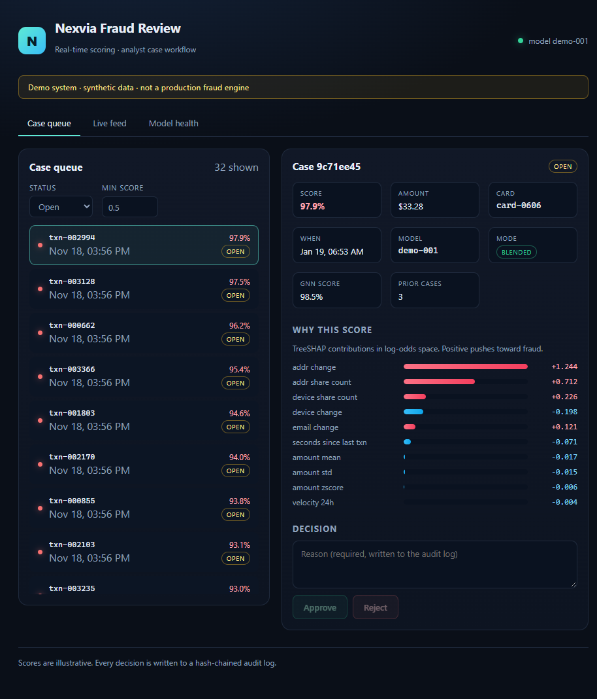
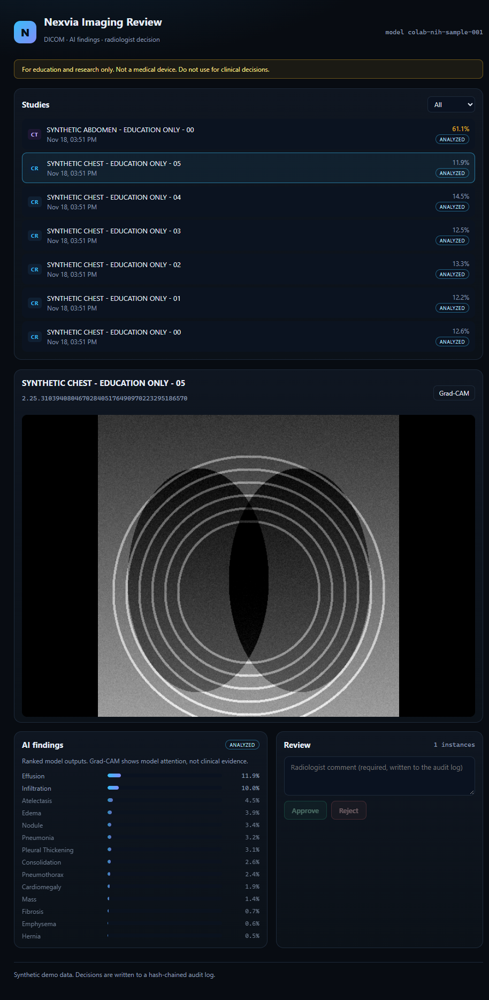

# Nexvia — AI/ML Portfolio

Single submission repository containing both allotted projects. Each project lives in its own folder with its own README, tests, and deliverables.

| Folder | Brief | Course project | Project | Status |
|---|---|---|---|---|
| [`AIML-01/`](AIML-01/) | AIML-01 | Project 2 | Nexvia Fraud — real-time fraud detection | **Built** |
| [`AIML-02/`](AIML-02/) | AIML-02 | Project 1 | Nexvia Imaging — medical imaging | **Next** |

> Both are education projects. The fraud system runs on synthetic data; the imaging system will use public research datasets with an explicit "not for clinical use" notice.

## Repository layout

```
.
├── AIML-01/               # project 2: fraud (complete)
│   ├── src/nexvia_fraud/  # API, streaming, features, models, drift, audit
│   ├── dashboard/         # React + Vite review UI
│   ├── tests/             # unit + integration
│   ├── artifacts/demo/    # trained XGBoost, GraphSAGE, blend, reference data
│   ├── docker-compose.yml
│   ├── k8s/               # Kustomize manifests
│   └── docs/              # architecture, API, model card, limitations
├── AIML-02/               # project 1: imaging (scaffold)
├── docs/superpowers/      # design spec and implementation plans
├── .github/workflows/     # CI for the whole repository
└── README.md
```

## Quickstart — fraud project

Requires Docker Desktop with Compose.

```bash
cd AIML-01
docker compose up --build
```

- Dashboard: <http://localhost:5173>
- API docs: <http://localhost:8000/docs>

Without Docker:

```bash
cd AIML-01
python -m pip install -e ".[dev]"
python -m nexvia_fraud.data.generate_demo --n 5000 --out data/demo/transactions.csv
python -m nexvia_fraud.models.train --data data/demo/transactions.csv --out artifacts/demo --run-id demo-001
python -m nexvia_fraud.models.gnn --data data/demo/transactions.csv --out artifacts/demo --run-id demo-gnn-001
python scripts/seed.py --limit 600
uvicorn nexvia_fraud.api.app:app --port 8000
```

Full details, metrics, architecture diagrams, and limitations are in [`AIML-01/README.md`](AIML-01/README.md).

## Screenshots

| Fraud case review | Imaging study review |
|---|---|
|  |  |

More: [`AIML-01/docs/screenshots`](AIML-01/docs/screenshots) · [`AIML-02/docs/screenshots`](AIML-02/docs/screenshots)

## What is demonstrated

- **Streaming correctness:** at-least-once Kafka delivery, idempotent writes, fail-fast consumer.
- **Point-in-time features:** strictly-before event semantics, tested for leakage.
- **Imbalance-aware ML:** PR-AUC, precision/recall at a fixed FPR, precision@100, calibration caveats.
- **Graph learning:** heterogeneous GraphSAGE with a pre-test-graph evaluation to avoid future edges.
- **Model operations:** Evidently drift reports, one-open-request retraining gate, hash-chained audit log.
- **Serving:** FastAPI with measured p50/p99, graceful XGBoost-only fallback.
- **Delivery:** Docker Compose, Kustomize manifests, GitHub Actions, committed demo artifacts.

## Tests

```bash
cd AIML-01
python -m pytest -m "not integration" -q   # 71 unit tests
python -m pytest -m integration -q          # requires Docker services
cd dashboard && npm test && npm run build
```

CI runs the unit and dashboard suites on every push; the integration suite runs on `workflow_dispatch` and nightly.

## Documentation

- Design and decisions: [`docs/superpowers/specs/2026-11-11-two-ml-platforms-design.md`](docs/superpowers/specs/2026-11-11-two-ml-platforms-design.md)
- Implementation plans: [`docs/superpowers/plans/`](docs/superpowers/plans/)
- Fraud architecture: [`AIML-01/docs/architecture.md`](AIML-01/docs/architecture.md)
- Fraud API: [`AIML-01/docs/api.md`](AIML-01/docs/api.md)
- Model card: [`AIML-01/docs/model-card.md`](AIML-01/docs/model-card.md)
- Limitations: [`AIML-01/docs/limitations.md`](AIML-01/docs/limitations.md)
- Kubernetes: [`AIML-01/docs/kubernetes.md`](AIML-01/docs/kubernetes.md)
- Data and Kaggle setup: [`docs/data-setup.md`](docs/data-setup.md)

## Submission note

The original design proposed two standalone repositories. The evaluation allows a single GitHub URL and asks for subfolders per project, so the projects are consolidated here. The fraud project's full commit history was imported with `git subtree`, so its development history remains inspectable.

## Data and ethics

No Kaggle or medical data is redistributed. Demo fraud data is generated deterministically by `AIML-01/src/nexvia_fraud/data/generate_demo.py`. The imaging project will use public research datasets under their licenses and will carry a prominent non-clinical-use notice.

## Repository conventions

- Python 3.11, Node 24, TypeScript strict.
- Conventional commits.
- No secrets committed; `.env.example` documents every variable.
- CI at the repository root; each project owns its tests.

## Submission checklist

See [`SUBMISSION.md`](SUBMISSION.md) for the requirement matrix, metrics, screenshots, and known gaps.

## Presentations

- [`presentations/AIML-01.pptx`](presentations/AIML-01.pptx) — fraud, 10 slides
- [`presentations/AIML-02.pptx`](presentations/AIML-02.pptx) — imaging, 10 slides
