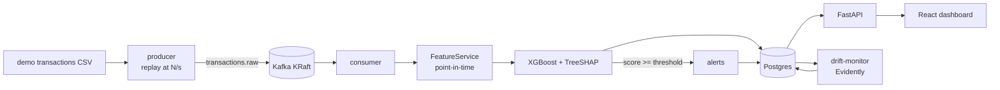

# nexvia-fraud

Real-time transaction fraud scoring: a replayed Kafka stream, an XGBoost scorer with TreeSHAP explanations, and an analyst case-review dashboard.

> **Education project.** Synthetic data only. Not a production fraud engine, and not a substitute for one.

**Status:** vertical slice + drift loop. Kafka → scorer → Postgres → dashboard works end to end, Evidently monitors feature drift, and a drift breach raises a retraining request for human review. Feast, the GNN, and Kubernetes are the next phase (see `docs/limitations.md`).

---

## Architecture



The API and the Kafka consumer call the same `score_transaction()` function. There is one definition of scoring and one idempotency key (`transaction_id`).

## Stack

| Layer | Choice |
|---|---|
| Stream | Kafka 3.7, KRaft mode, single broker |
| Model | XGBoost (CPU), TreeSHAP contributions, early stopping on PR-AUC |
| API | FastAPI + Uvicorn |
| Storage | PostgreSQL 16 (SQLite for local tests) |
| Drift | Evidently `DataDriftPreset` against a committed training reference |
| Dashboard | React 18 + Vite + TypeScript (strict) |
| Packaging | Docker Compose, GitHub Actions |

## Quickstart

Requirements: Docker Desktop with Compose.

```bash
docker compose up --build
```

- Dashboard: <http://localhost:5173>
- API docs: <http://localhost:8000/docs>
- Health: <http://localhost:8000/health>

The `seed` service loads 600 demo transactions and creates alerts, so the queue is populated even before the producer starts. The producer then replays the stream at 2 transactions/second.

### Without Docker

```bash
python -m pip install -e ".[dev]"
python -m nexvia_fraud.data.generate_demo --n 5000 --out data/demo/transactions.csv
python -m nexvia_fraud.models.train --data data/demo/transactions.csv --out artifacts/demo --run-id demo-001
python scripts/seed.py --limit 600
python scripts/drift_job.py --once
uvicorn nexvia_fraud.api.app:app --port 8000
```

In a second terminal:

```bash
cd dashboard && npm install && npm run dev
```

Kafka and the consumer require Docker Compose; the API, scorer, and dashboard do not.

## Demo script (5 minutes)

1. Open the dashboard. Point out the banner: synthetic demo, not a production engine.
2. **Live feed** — transactions arriving from the producer, with scores.
3. **Case queue** — filter by minimum score. Pick an alert with a high score.
4. **Case detail** — amount, card, prior cases, and the SHAP bars showing which features pushed the score up or down.
5. Enter a reason, click **Reject** (or Approve). The status changes and an audit hash is shown.
6. **Model health** — drift share, per-feature drift scores, and any retraining requests. Approve or reject a request; nothing retrains automatically.
7. `GET /audit` returns the hash-chained log with `valid: true`.
8. `GET /metrics` shows request count and in-process p50/p95/p99.

## Model and results

Trained on the committed synthetic dataset (`data/demo/transactions.csv`, 5,000 rows, time-ordered split 80/20).

| Metric | Value |
|---|---|
| PR-AUC | **0.740** |
| ROC-AUC | 0.877 |
| Precision @ 1% FPR | 0.836 |
| Recall @ 1% FPR | 0.719 |
| Precision @ 100 | 0.48 |
| Test prevalence | 0.064 |
| Test rows / fraud rows | 1,000 / 64 |
| Train / validation / test | 3,500 / 500 / 1,000 |
| Run ID | `demo-001` |
| Best iteration | 17 of 300 (early stopping on validation) |

Source of truth: `artifacts/demo/metrics.json` and `reports/metrics.json`. Early stopping uses a time-ordered validation slice carved out of the training window; the final 20% is untouched until metrics are computed. The model is trained on **synthetic data with injected fraud rings, entity evasion, shared-device false positives, and 1% label noise** — not on real transactions.

## Latency

Measured on the development machine (Windows 11, CPU-only, single Uvicorn worker, SQLite), 300 sequential requests to `/score`:

| p50 | p95 | p99 | Mean | Sequential throughput |
|---|---|---|---|---|
| 19.0 ms | 22.8 ms | 25.6 ms | 19.5 ms | ~51 req/s |

This is a demo-scale number, not a capacity claim. It includes feature computation, model inference, SHAP, and the database write.

## Repository layout

```
src/nexvia_fraud/
  api/          FastAPI app, schemas, metrics
  audit/        hash-chained audit log
  data/         deterministic synthetic data generator
  db/           SQLAlchemy models, repository, engine helpers
  features/     point-in-time feature service
  models/       training and scoring
  streaming/    Kafka producer/consumer and transports
dashboard/      React + Vite UI
scripts/        seed, replay, benchmark
tests/          unit + integration (Kafka/Postgres opt-in)
```

## Tests

```bash
python -m pytest -m "not integration" -q   # unit, 62 tests
python -m pytest -m integration -q          # needs KAFKA_BOOTSTRAP
cd dashboard && npm test && npm run build
```

The integration test publishes a real message through Kafka, consumes it, scores it, and asserts the row exists.

## Documentation

- `docs/architecture.md` — components, request paths, drift flow
- `docs/api.md` — endpoints and payloads
- `docs/model-card.md` — data, metrics, intended use
- `docs/limitations.md` — bias, leakage risks, non-goals

## Drift and retraining

- The training run writes `artifacts/demo/reference_features.parquet` — the training distribution of all 13 features.
- `drift-monitor` (a Compose service) reads the 500 most recent scored transactions, runs Evidently's `DataDriftPreset`, and stores a report in `drift_reports`.
- When the drifted-column share crosses `DRIFT_SHARE_THRESHOLD` (default 0.5), exactly one **open** retraining request is created. Re-running the job does not spam requests.
- A human approves or rejects the request in the Model health tab or via `POST /retraining-requests/{id}/resolve`. Nothing retrains or promotes automatically.
- Fewer than `DRIFT_MIN_ROWS` (default 50) current rows produces `insufficient_data`, not a false alarm; a missing reference file produces `reference_missing`.

## Data and licensing

No Kaggle or medical data is redistributed. The demo dataset is generated by `src/nexvia_fraud/data/generate_demo.py` and is clearly synthetic. The design notes call for IEEE-CIS via the user's Kaggle credentials in the depth phase.

## Ethics

Fraud scores affect people. This project exists to demonstrate engineering, not to make decisions about real accounts. Any deployment would need fairness evaluation, human review, appeal paths, and regulatory review that this demo does not provide.
