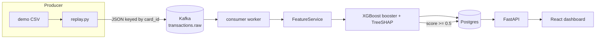
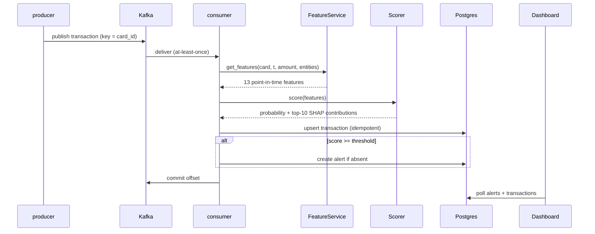
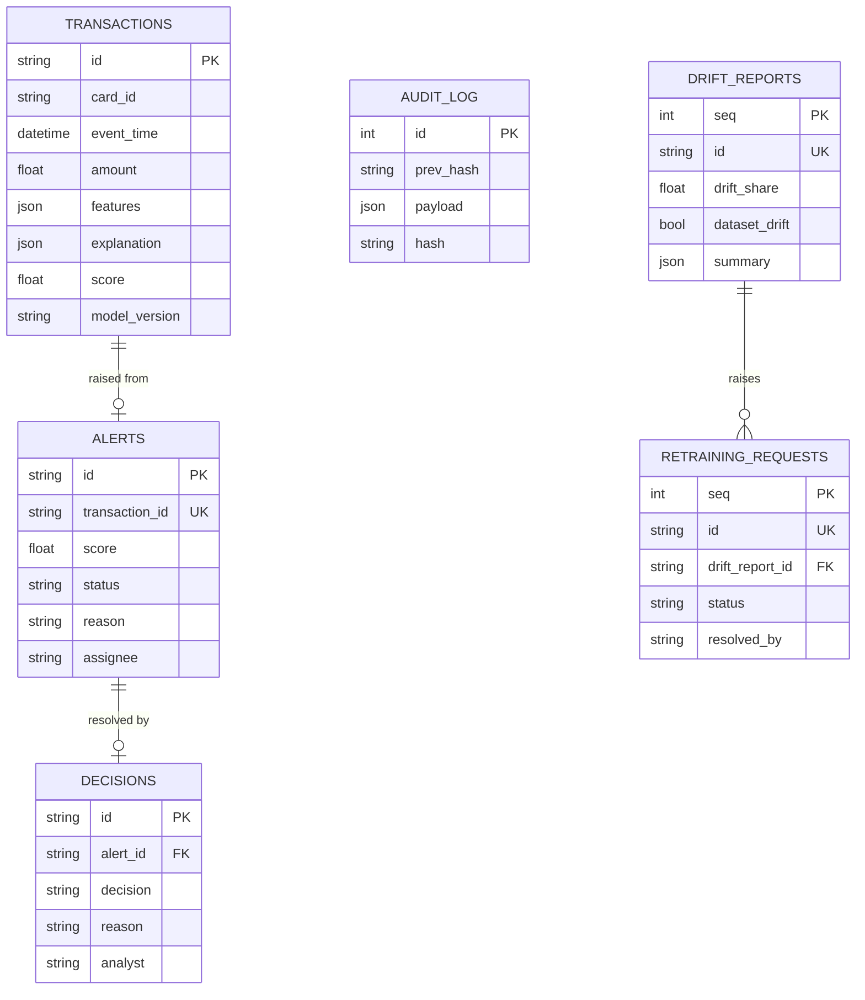
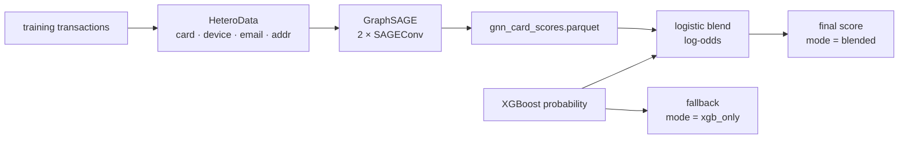
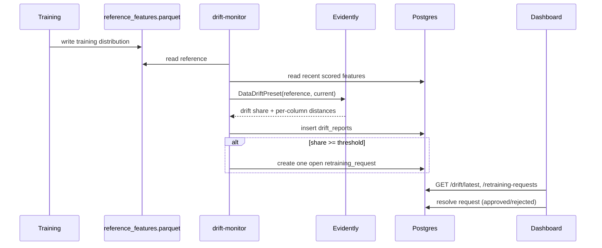
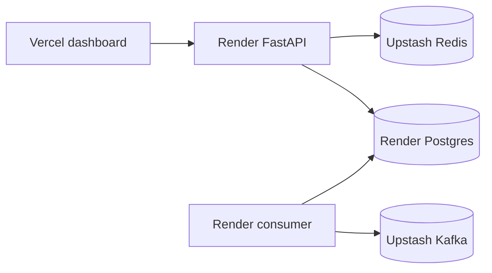

# Architecture

## Context

## Scoring path

## Why the API and consumer share code

`score_transaction()` is the only place that assembles features, runs the model, persists the transaction, and raises an alert. The HTTP endpoint and the Kafka consumer both call it. This prevents the most common streaming bug: two scoring paths that drift apart.

## Idempotency

- Kafka delivers at least once.
- `transactions.id` is the transaction ID, so `upsert_transaction()` collapses replays.
- `alerts.transaction_id` is unique, so `create_alert_if_absent()` cannot duplicate a case.
- The consumer commits the offset only after the write succeeds.

## Data model

## Graph model and blend

- GraphSAGE is trained on cards from the training window with a seeded 70/15/15 card split, so test cards are unseen.
- Evaluation uses embeddings from a graph built only from rows before the test window. Serving uses a nightly full-graph precompute; that is a freshness/leakage trade-off documented in the model card.
- The blender is a two-coefficient logistic regression fit on the validation window. A card with no GNN score falls back to XGBoost-only, and the response says which path ran.

## Drift flow

The job is deliberately conservative: insufficient current data returns `insufficient_data`, a missing reference returns `reference_missing`, and repeated runs during one episode do not create a second open request. A request is a prompt for a human, never an automatic retrain.

## Audit chain

Each row hashes `prev_hash || canonical_json(payload)`, and a singleton head row stores the latest hash under a row lock. Verification walks the chain from the genesis value and then compares the final link to the head. Mutation of a payload, or deletion of the tail, breaks verification. An attacker who can write both `audit_log` and `audit_head` can still rewrite history — external anchoring is not implemented (see `docs/limitations.md`).

## Deployment topology (hosted, later phase)

Compose remains the full-fidelity demo. Hosted deployment is deferred until the depth phase.
