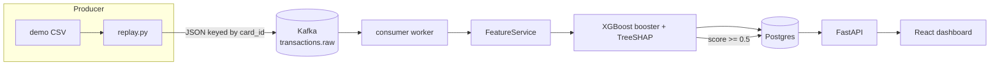
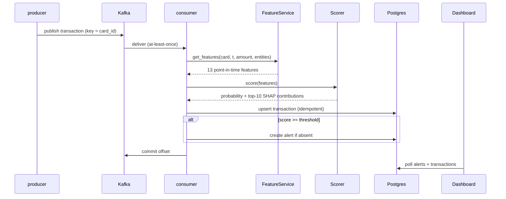
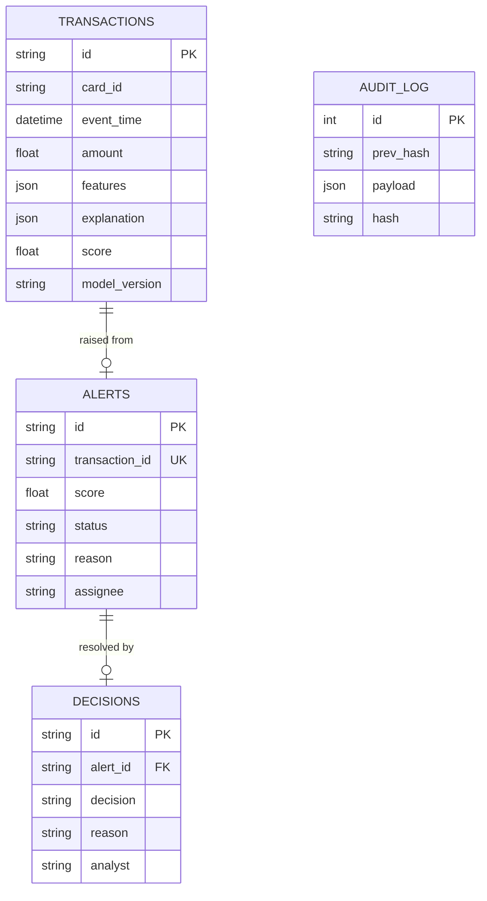
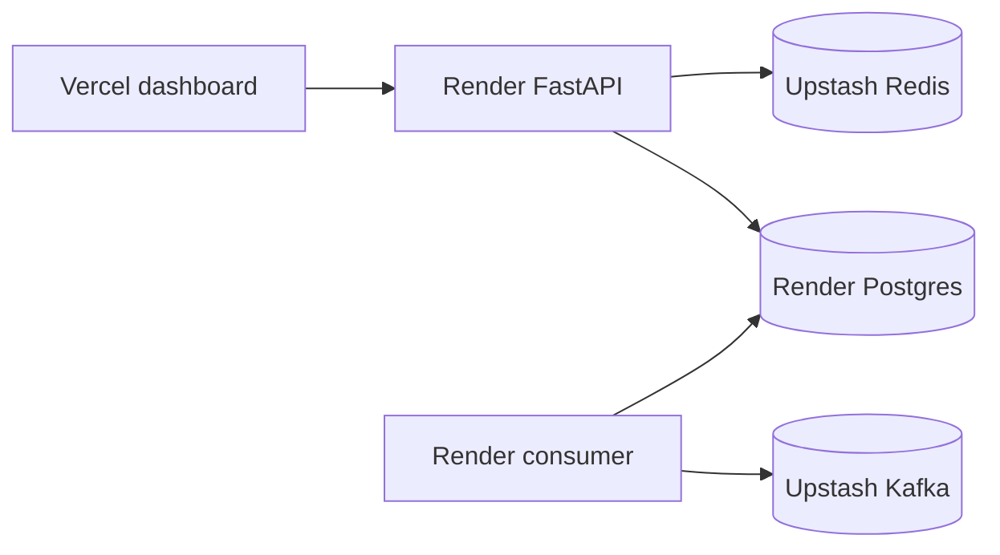

# Architecture

## Context

## Scoring path

## Why the API and consumer share code

`score_transaction()` is the only place that assembles features, runs the model, persists the transaction, and raises an alert. The HTTP endpoint and the Kafka consumer both call it. This prevents the most common streaming bug: two scoring paths that drift apart.

## Idempotency

- Kafka delivers at least once.
- `transactions.id` is the transaction ID, so `upsert_transaction()` collapses replays.
- `alerts.transaction_id` is unique, so `create_alert_if_absent()` cannot duplicate a case.
- The consumer commits the offset only after the write succeeds.

## Data model

## Audit chain

Each row hashes `prev_hash || canonical_json(payload)`. Verification walks the chain from the genesis value and compares every link. Mutation of any row breaks its hash and every subsequent link. Truncation of the tail is **not** detectable without an externally anchored head — documented in `docs/limitations.md`.

## Deployment topology (hosted, later phase)

Compose remains the full-fidelity demo. Hosted deployment is deferred until the depth phase.
